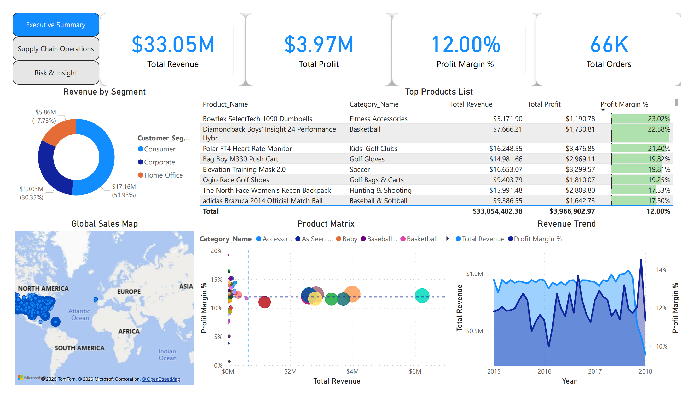
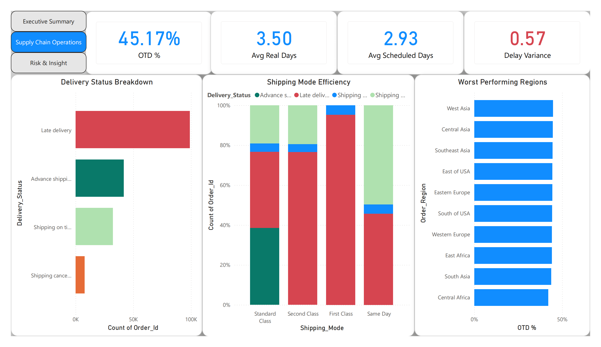
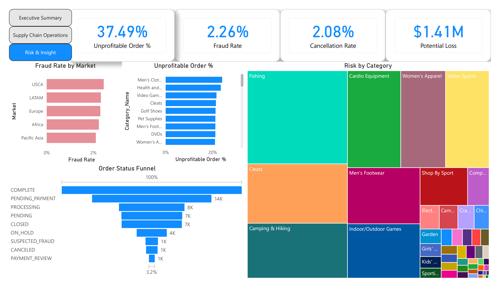

# DataCo Supply Chain Analysis Dashboard

> **Personal project** built on a **public Kaggle dataset** (DataCo Smart Supply Chain) to practice the full path from SQL Server to a Power BI report. It contains no employer data.

A 3-page Power BI dashboard (Executive Summary · Supply Chain Operations · Risk & Insight) on **180,519 order lines (65,752 orders, Jan 2015 – Jan 2018)**, served from SQL Server. The headline KPIs are cross-checked against T-SQL queries on the raw table.



---

## Key Findings

**1. Late delivery is a shipping-mode problem, not a geography problem.**

| Shipping mode | Order lines | Late rate | Scheduled days | Actual days (avg) |
|---|---:|---:|---:|---:|
| First Class | 27,814 | **95.3%** | 1 | 2.0 |
| Second Class | 35,216 | **76.6%** | 2 | 4.0 |
| Same Day | 9,737 | 45.7% | 0 | 0.5 |
| Standard Class | 107,752 | 38.1% | 4 | 4.0 |

- Overall on-time delivery (OTD) is **45.2%**; the average shipment takes 3.50 days against 2.93 scheduled (a 0.57-day gap).
- The premium modes miss because the **promise is shorter than the actual transit time**: First Class averages 2 days against a 1-day schedule, Second Class 4 days against 2. Standard Class meets its 4-day schedule.
- By contrast, OTD only ranges from **42.0% to 51.2% across 23 regions** (44.8–45.6% across the 5 markets), so region explains far less than shipping mode.

**2. Profitability: 12.0% margin on $33.05M revenue, with loss-making lines spread evenly.**
- **37.5%** of orders contain at least one loss-making line (the dashboard's *Unprofitable Order %*); **21.2%** of orders lose money overall.
- About **19%** of order lines lose money, and that share barely moves by discount rate (18.1–19.6%), shipping mode, market or late vs. on-time delivery. None of these factors explains the losses (`profitability_and_risk_analysis.sql`).

**3. Risk: 2.26% suspected fraud and 2.08% cancellations, worth $1.41M in revenue.**
- Fraud rates are similar across all 5 markets (2.10–2.44%), so there is no single market hotspot.

---

## Dashboard Pages

| Page | What it shows |
|---|---|
| **Executive Summary** | Revenue, profit, margin and order KPIs; revenue/margin trend by month; revenue by segment; product scatter matrix (revenue vs. margin by category); top products by margin; global sales map |
| **Supply Chain Operations** | OTD %, actual vs. scheduled days, delay variance; delivery status breakdown; delivery status mix by shipping mode; OTD by region |
| **Risk & Insight** | Fraud rate, cancellation rate, potential loss, unprofitable order %; fraud rate by market; order status funnel; unprofitable order % by category; potential loss by category |

Pages are linked by navigation buttons; selecting a shipping mode, region or category cross-filters every KPI on the page.




---

## Data Model & DAX

- **Source:** the raw CSV loaded into a local SQL Server database (`DataCo_SupplyChain`), imported into Power BI through Power Query (date columns typed for time analysis).
- **Model:** `Fact_Orders` (one row per order line) + `Dim_Date` (DAX `CALENDAR` over the order-date range, with year and month columns).
- **14 DAX measures**, for example:

| Measure | Definition |
|---|---|
| `Total Orders` | `DISTINCTCOUNT(Fact_Orders[Order_Id])`, so order KPIs count orders, not lines |
| `OTD %` | `1 - [Test_Late_Rate]` (late lines ÷ all lines, via `CALCULATE`) |
| `Delay Variance` | `[Avg Real Days] - [Avg Scheduled Days]` |
| `Profit Margin %` | `DIVIDE([Total Profit], [Total Revenue])` |
| `Fraud Rate` / `Cancellation Rate` | `DIVIDE(CALCULATE([Total Orders], Order_Status = …), [Total Orders])` |
| `Potential Loss` | Revenue on `SUSPECTED_FRAUD` + `CANCELED` orders |
| `Unprofitable Order %` | Orders with at least one line where `Benefit_per_order < 0` ÷ all orders |

**Metric notes**
- OTD % is line-weighted; canceled lines stay in the denominator. No order uses more than one shipping mode, so order-level and line-level late rates by mode match closely.
- `Benefit_per_order` is recorded per order line in this dataset.

---

## SQL Validation & Analysis (`sql_queries/`)

| Script | Purpose |
|---|---|
| `data_validation_and_exploration.sql` | Grain check (lines vs. orders), date coverage, revenue / profit / margin and late-rate checks against the dashboard cards |
| `delivery_performance_analysis.sql` | Late rate and actual vs. scheduled days by shipping mode; OTD by region (ranked, with spread) and by market |
| `profitability_and_risk_analysis.sql` | Two definitions of unprofitable orders; loss-line share by discount rate, shipping mode, market and delivery status; fraud and cancellation exposure by market |

---

## Tech Stack
- **Visualization:** Power BI Desktop (DAX, Power Query)
- **Database & validation:** SQL Server Express (T-SQL)
- **Data:** DataCo Smart Supply Chain for Big Data Analysis (CSV)

## Repository Structure
```text
├── assets/                                  # Dashboard screenshots
├── sql_queries/
│   ├── data_validation_and_exploration.sql
│   ├── delivery_performance_analysis.sql
│   └── profitability_and_risk_analysis.sql
├── supplychain_analysis.pbix                # Power BI report
├── supplychain_analysis.pdf                 # PDF export of the 3 pages
└── README.md
```

## How to Reproduce
1. Download `DataCoSupplyChainDataset.csv` from Kaggle (link below).
2. Import it into SQL Server as `dbo.DataCoSupplyChainDataset` in a database named `DataCo_SupplyChain`.
3. Run the scripts in `sql_queries/`.
4. Open `supplychain_analysis.pbix` and point the source at your server (Power Query → Data source settings).

## Dataset
- **Source:** [DataCo Smart Supply Chain for Big Data Analysis](https://www.kaggle.com/datasets/shashwatwork/dataco-smart-supply-chain-for-big-data-analysis) (Kaggle); original on [Mendeley Data](https://data.mendeley.com/datasets/8gx2fvg2k6/5), by Fabian Constante, Fernando Silva and António Pereira (CC BY 4.0).

---
*Author: Fred Zhao*
